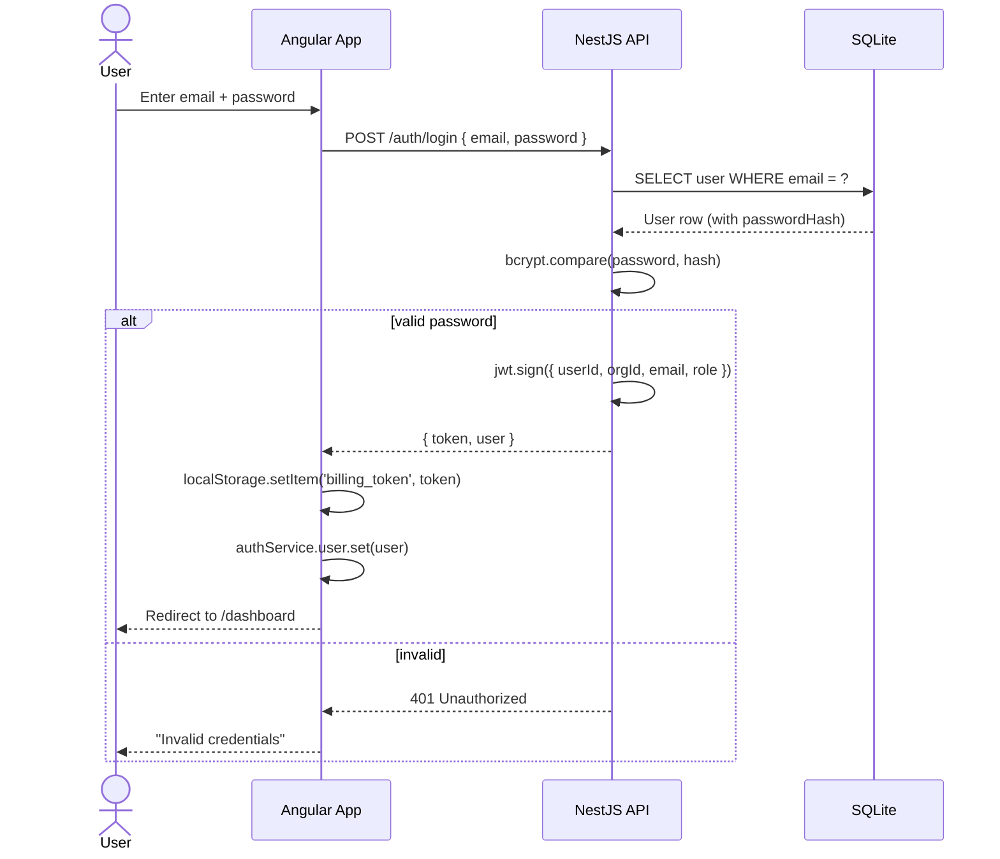

# API Reference

Base URL: `/api` (proxied by Angular dev server on port 4200, direct on port 3000)  
Auth: All endpoints except `/auth/register` and `/auth/login` require a JWT Bearer token in the `Authorization` header.

Swagger UI is available at `/api/docs` when the server is running.

---

## Auth Module

### `POST /auth/register`

Register a new organization with an admin user. Creates:
- Organization
- Admin user (role: `admin`)
- Default settings (currency: USD, tax rate: 0%)

**Request Body:**
```json
{
  "organizationName": "Acme SaaS",
  "name": "Admin User",
  "email": "admin@acme.com",
  "password": "password123"
}
```

**Response (201):**
```json
{
  "token": "eyJhbGciOiJIUzI1NiIs...",
  "user": {
    "id": "uuid",
    "email": "admin@acme.com",
    "name": "Admin User",
    "role": "admin",
    "organizationId": "uuid"
  },
  "organization": {
    "id": "uuid",
    "name": "Acme SaaS"
  }
}
```

**Errors:** `409 Conflict` — Email already registered.

---

### `POST /auth/login`

Authenticate with email and password.

**Request Body:**
```json
{
  "email": "admin@acme.com",
  "password": "password123"
}
```

**Response (201):**
```json
{
  "token": "eyJhbGciOiJIUzI1NiIs...",
  "user": {
    "id": "uuid",
    "email": "admin@acme.com",
    "name": "Admin User",
    "role": "admin",
    "organizationId": "uuid"
  }
}
```

**Errors:** `401 Unauthorized` — Invalid credentials.

---

### `GET /auth/me`

Get the current authenticated user's profile. Requires Bearer token.

**Response (200):**
```json
{
  "id": "uuid",
  "email": "admin@acme.com",
  "name": "Admin User",
  "role": "admin",
  "organizationId": "uuid",
  "organizationName": "Acme SaaS"
}
```

---

## Plans Module

All endpoints require JWT auth. All operations are scoped to the user's organization.

### `GET /plans`

List all plans for the organization.

**Response (200):**
```json
[
  {
    "id": "uuid",
    "organizationId": "uuid",
    "name": "Basic",
    "description": "Basic plan with core features",
    "price": 29.99,
    "cycle": "monthly",
    "features": { "features": ["5 users", "Basic analytics"] },
    "isActive": true,
    "createdAt": "2026-07-05T00:00:00.000Z",
    "updatedAt": "2026-07-05T00:00:00.000Z"
  }
]
```

### `GET /plans/:id`

Get a single plan by ID.

**Response (200):** Single plan object (same shape as above).  
**Errors:** `404 Not Found`.

### `POST /plans`

Create a new plan.

**Request Body:**
```json
{
  "name": "Pro",
  "description": "Professional plan for growing businesses",
  "price": 99.00,
  "cycle": "monthly",
  "features": { "features": ["25 users", "Advanced analytics"] },
  "isActive": true
}
```

**Response (201):** Created plan object.

### `PUT /plans/:id`

Update an existing plan. All fields optional.

**Request Body:** (partial update)
```json
{
  "price": 79.00
}
```

**Response (200):** Updated plan object.  
**Errors:** `404 Not Found`.

### `DELETE /plans/:id`

Delete a plan. **Blocks if** the plan has active subscriptions.

**Response (200):**
```json
{ "deleted": true }
```

**Errors:** `409 Conflict` — Cannot delete plan with active subscriptions.  
`404 Not Found`.

---

## Customers Module

All endpoints require JWT auth. Scoped to organization.

### `GET /customers`

List customers with optional search and pagination.

**Query Parameters:**
| Param | Type | Default | Description |
|-------|------|---------|-------------|
| `search` | `string?` | — | Search by customer name (LIKE query) |
| `page` | `number?` | `1` | Page number |
| `limit` | `number?` | `10` | Results per page |

**Response (200):**
```json
{
  "data": [
    {
      "id": "uuid",
      "organizationId": "uuid",
      "name": "John Smith",
      "email": "john@example.com",
      "phone": "+1-555-0101",
      "company": "Tech Corp",
      "createdAt": "2026-07-05T00:00:00.000Z",
      "updatedAt": "2026-07-05T00:00:00.000Z"
    }
  ],
  "total": 5,
  "page": 1,
  "limit": 10
}
```

### `GET /customers/:id`

Get a single customer by ID.

**Response (200):** Single customer object.  
**Errors:** `404 Not Found`.

### `POST /customers`

Create a new customer.

**Request Body:**
```json
{
  "name": "John Smith",
  "email": "john@example.com",
  "phone": "+1-555-0101",
  "company": "Tech Corp"
}
```

**Response (201):** Created customer object.

### `PUT /customers/:id`

Update a customer. All fields optional.

**Request Body:**
```json
{
  "company": "New Corp Inc."
}
```

**Response (200):** Updated customer object.  
**Errors:** `404 Not Found`.

### `DELETE /customers/:id`

Delete a customer.

**Response (200):**
```json
{ "deleted": true }
```

**Errors:** `404 Not Found`.

---

## Subscriptions Module

All endpoints require JWT auth. Scoped to organization.

### `GET /subscriptions`

List all subscriptions with customer and plan relations loaded.

**Response (200):**
```json
[
  {
    "id": "uuid",
    "organizationId": "uuid",
    "customerId": "uuid",
    "planId": "uuid",
    "status": "active",
    "startDate": "2026-04-05",
    "endDate": "2026-05-05",
    "cancelledAt": null,
    "customer": {
      "id": "uuid",
      "name": "John Smith",
      "email": "john@example.com"
    },
    "plan": {
      "id": "uuid",
      "name": "Pro",
      "price": 99.00,
      "cycle": "monthly"
    },
    "createdAt": "2026-07-05T00:00:00.000Z",
    "updatedAt": "2026-07-05T00:00:00.000Z"
  }
]
```

### `GET /subscriptions/:id`

Get a single subscription with customer and plan relations.

**Response (200):** Single subscription object.  
**Errors:** `404 Not Found`.

### `POST /subscriptions`

Create a new subscription. **Auto-generates the first invoice** (draft status) for the plan's price.

**Request Body:**
```json
{
  "customerId": "uuid",
  "planId": "uuid"
}
```

**Response (201):** Created subscription with customer and plan relations.

**Errors:** `404 Not Found` — Customer or plan not found.

### `POST /subscriptions/:id/cancel`

Cancel an active subscription. Sets `status = 'cancelled'`, records `cancelledAt`, sets `endDate` to today.

**Response (200):** Updated subscription object.

**Errors:** `400 Bad Request` — Already cancelled.  
`404 Not Found`.

### `POST /subscriptions/:id/reactivate`

Reactivate a cancelled subscription. Resets `status = 'active'`, sets new `startDate`/`endDate` based on plan cycle, clears `cancelledAt`.

**Response (200):** Updated subscription object.

**Errors:** `400 Bad Request` — Already active.  
`404 Not Found`.

### `POST /subscriptions/:id/change-plan`

Change the plan on an active subscription with day-weighted proration.

**Request Body:**
```json
{
  "newPlanId": "uuid"
}
```

**Behavior:**
1. Validates subscription is active and new plan differs from current.
2. Calculates days in current billing period.
3. Computes credit for remaining days on current plan.
4. Computes charge for remaining days on new plan.
5. Adjustment = newCharge - credit.
6. Updates subscription to new plan.
7. If adjustment ≠ $0, creates an adjustment invoice (credit or charge).

**Response (200):** Updated subscription with new plan relation.

**Errors:** `400 Bad Request` — Not active or same plan.  
`404 Not Found` — Plan not found.

---

## Invoices Module

All endpoints require JWT auth. Scoped to organization.

### `GET /invoices`

List all invoices with customer and items relations loaded.

**Response (200):**
```json
[
  {
    "id": "uuid",
    "organizationId": "uuid",
    "customerId": "uuid",
    "subscriptionId": "uuid",
    "invoiceNumber": "INV-1743868800000-X7K9",
    "status": "paid",
    "subtotal": 99.00,
    "tax": 9.90,
    "total": 108.90,
    "issueDate": "2026-04-05",
    "dueDate": "2026-05-05",
    "paidAt": "2026-04-06T00:00:00.000Z",
    "sentAt": "2026-04-05T00:00:00.000Z",
    "customer": {
      "id": "uuid",
      "name": "John Smith"
    },
    "items": [
      {
        "id": "uuid",
        "invoiceId": "uuid",
        "description": "Pro - Monthly subscription",
        "quantity": 1,
        "unitPrice": 99.00,
        "total": 99.00,
        "sortOrder": 0
      }
    ],
    "createdAt": "2026-07-05T00:00:00.000Z",
    "updatedAt": "2026-07-05T00:00:00.000Z"
  }
]
```

### `GET /invoices/:id`

Get a single invoice with customer, items, and subscription relations.

**Response (200):** Single invoice object.  
**Errors:** `404 Not Found`.

### `POST /invoices`

Create a manual invoice with line items.

**Request Body:**
```json
{
  "customerId": "uuid",
  "subscriptionId": "uuid",
  "items": [
    {
      "description": "Consulting services",
      "quantity": 1,
      "unitPrice": 150.00
    },
    {
      "description": "Setup fee",
      "quantity": 1,
      "unitPrice": 50.00
    }
  ],
  "taxRate": 10,
  "issueDate": "2026-07-05",
  "dueDate": "2026-08-05"
}
```

**Response (201):** Created invoice with items.

### `POST /invoices/:id/send`

Transition invoice from `draft` → `sent`. Records `sentAt`.

**Response (200):** Updated invoice object.

**Errors:** `400 Bad Request` — Cannot send invoice in non-draft status.  
`404 Not Found`.

### `POST /invoices/:id/pay`

Record a payment and transition invoice to `paid`. Works from `sent` or `overdue` status.

**Request Body:**
```json
{
  "method": "transfer",
  "amount": 150.00,
  "reference": "PAY-REF-001",
  "paymentDate": "2026-07-05"
}
```

**Response (200):** Updated invoice object.

**Errors:** `400 Bad Request` — Already paid or cancelled.  
`404 Not Found`.

### `POST /invoices/:id/cancel`

Cancel an invoice. Works from `draft`, `sent`, or `overdue`. Cannot cancel a paid invoice.

**Response (200):** Updated invoice object.

**Errors:** `400 Bad Request` — Already paid or already cancelled.  
`404 Not Found`.

### `POST /invoices/:id/mark-overdue`

Mark a sent invoice as overdue.

**Response (200):** Updated invoice object.

**Errors:** `400 Bad Request` — Invoice is not in `sent` status.  
`404 Not Found`.

---

## Dashboard Module

All endpoints require JWT auth. Scoped to organization.

### `GET /dashboard/kpis`

Get key performance indicators.

**Response (200):**
```json
{
  "mrr": 527.00,
  "totalActiveSubscriptions": 5,
  "totalRevenue": 1168.50,
  "churnRate": 25,
  "totalSubscriptions": 8,
  "cancelledSubscriptions": 2
}
```

**Fields:**
| Field | Description |
|-------|-------------|
| `mrr` | Monthly Recurring Revenue (yearly plans ÷ 12) |
| `totalActiveSubscriptions` | Count of subscriptions with status `active` |
| `totalRevenue` | Sum of all paid invoice totals |
| `churnRate` | (cancelled / total) × 100 |
| `totalSubscriptions` | Count of all subscriptions |
| `cancelledSubscriptions` | Count of cancelled subscriptions |

### `GET /dashboard/revenue-chart`

Get monthly revenue data for the last 12 months.

**Response (200):**
```json
[
  { "month": "2025-08", "revenue": 0 },
  { "month": "2025-09", "revenue": 0 },
  { "month": "2025-10", "revenue": 0 },
  { "month": "2025-11", "revenue": 0 },
  { "month": "2025-12", "revenue": 0 },
  { "month": "2026-01", "revenue": 0 },
  { "month": "2026-02", "revenue": 0 },
  { "month": "2026-03", "revenue": 138.9 },
  { "month": "2026-04", "revenue": 377.7 },
  { "month": "2026-05", "revenue": 187.8 },
  { "month": "2026-06", "revenue": 267.8 },
  { "month": "2026-07", "revenue": 196.3 }
]
```

Each entry is revenue from paid invoices whose `paidAt` falls within that calendar month.

### `GET /dashboard/overdue-invoices`

List overdue invoices with customer relation, ordered by due date ascending.

**Response (200):**
```json
[
  {
    "id": "uuid",
    "invoiceNumber": "INV-DEMO-...",
    "total": 299.00,
    "dueDate": "2026-06-15",
    "customer": { "id": "uuid", "name": "Mike Chen" }
  }
]
```

### `GET /dashboard/subscription-summary`

Returns active vs cancelled counts.

**Response (200):**
```json
{
  "active": 6,
  "cancelled": 2,
  "total": 8
}
```

---

## Settings Module

All endpoints require JWT auth.

### `GET /settings`

Get organization settings.

**Response (200):**
```json
{
  "organizationId": "uuid",
  "orgName": "Acme SaaS",
  "currency": "USD",
  "defaultTaxRate": 10,
  "updatedAt": "2026-07-05T00:00:00.000Z"
}
```

### `PUT /settings`

Update organization settings.

**Request Body:**
```json
{
  "orgName": "Acme SaaS Inc.",
  "currency": "EUR",
  "defaultTaxRate": 20
}
```

All fields are optional.

**Response (200):** Updated settings object.

---

## Auth Flow



### Registration Flow

```
POST /auth/register { organizationName, name, email, password }
  → 1. Check email uniqueness (query users table)
  → 2. Create Organization
  → 3. Create Settings (default currency=USD, taxRate=0)
  → 4. Hash password with bcrypt (10 rounds)
  → 5. Create User with role='admin'
  → 6. Sign JWT with { userId, orgId, email, role }
  → 7. Return { token, user, organization }
```

### JWT Payload

```json
{
  "userId": "uuid",
  "organizationId": "uuid",
  "email": "admin@acme.com",
  "role": "admin",
  "iat": 1743868800,
  "exp": 1744473600
}
```

The token is signed with `HS256` using the `JWT_SECRET` env var. Expiry is configurable via `JWT_EXPIRES_IN` (default: `7d`).
